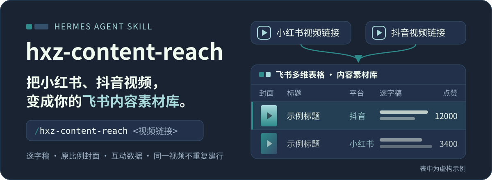
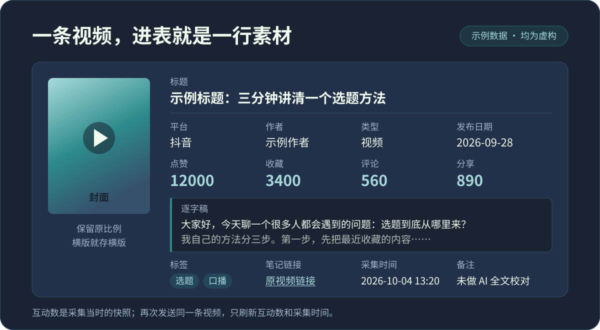
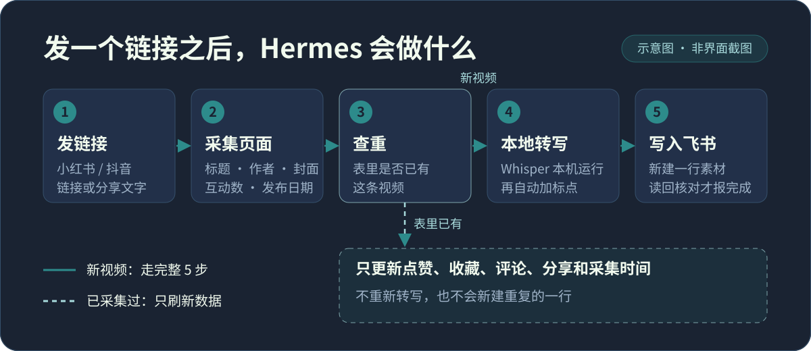

<p align="center">
  
</p>

<p align="center"><b>简体中文</b> · <a href="./README.en.md">English</a></p>

**把小红书、抖音视频，变成你的飞书内容素材库。**

看到值得留存的视频，不用自己抄文案、存封面、搬数据。在 Hermes 里发一个链接，它会帮你把视频转成文字，连同封面、作者和互动数据一起存进你指定的飞书多维表格。

## 先看你会得到什么

一条视频，对应表里一条素材：

<p align="center">
  
</p>

- **完整逐字稿**：把口播转成文字，加上标点和分段，方便阅读、检索和引用。
- **原始封面**：保留作者设置的封面及原比例。
- **来源信息**：标题、作者、平台、类型（如视频）、发布日期和原链接，方便回到原视频。
- **互动数据**：点赞、收藏、评论、分享，以及采集时间。
- **内容标签**：方便在表里整理素材。

适合把视频用作选题参考、学习资料、原文素材的人。它负责采集和整理，不替你改写成原创文章。

## 已经配置好？这样用就行

在 Hermes 的聊天输入框里发送：

```text
/hxz-content-reach <粘贴小红书或抖音视频链接>
```

从 App 复制的分享文字也可以直接粘贴：

```text
/hxz-content-reach <粘贴整段分享文字>
```

等待 Hermes 提示入库完成，然后打开你自己的飞书表查看。你不需要手动下载视频、整理逐字稿或上传封面。

<p align="center">
  
</p>

**再次发送同一条视频，不会重复建一条素材**，只会更新这次能读到的互动数据和采集时间。

如果你只想查看、不想写入表格，请明确说：

```text
/hxz-content-reach <视频链接> 先查看，不要入库。
```

## 第一次使用：让 Hermes 帮你准备

你需要准备三样东西：

1. **Hermes Agent**：用于安装和运行这个 Skill。
2. **飞书账号和一张素材表**：用于存放采集结果。
3. **能打开视频的 Chrome 浏览器**：需要登录时，由你本人登录。

安装 Skill 后，把下面这段话发给 Hermes，再附上你自己的飞书表链接：

```text
我要开始使用 hxz-content-reach。
这是我的飞书多维表格：<粘贴表格链接>。
请检查表格字段和本机运行环境，帮我完成必要配置。
需要安装软件或下载模型时，先说明用途、保存位置和需要我确认的事项。
登录授权由我本人完成；其他能代办的步骤请帮我做完。
准备好后，我会发一条视频链接试用。
```

这是一段让 Agent 协助配置的请求，不是一键安装器。第一次需要准备本地转写和标点模型，具体安装方法见 [docs/INSTALL.md](./docs/INSTALL.md)；日常使用不需要再操作这些工具。

如果你还没有素材表，可以先告诉 Hermes：

```text
我还没有飞书素材表，请帮我设计并创建一张适合 hxz-content-reach 的内容库。
```

创建新表前确认字段和权限。表里建议包含：标题、平台、作者、封面、逐字稿、类型、标签、发布日期、笔记链接、点赞、收藏、评论、分享、采集时间和备注。

## 试用第一条视频

选一条你有权处理、能正常播放的短视频，发送：

```text
/hxz-content-reach <视频链接>
```

完成后只需检查三件事：

- 飞书里出现了这条素材；
- 封面和来源对应正确；
- 逐字稿能正常阅读。

遇到错误，把 Hermes 的提示原样留在会话里，让它根据现场继续排查，不必自己理解技术报错。

## 用之前知道这几件事

- **转写不是人工精校**：默认在本机转写并加标点，专有名词或同音词可能有误。正式引用前，请对照原视频；需要进一步校对时，明确提出要求。
- **封面保留原比例**：作者用横版封面，就保存横版，不强行裁成竖版。
- **互动数据是采集时的快照**：平台之后的变化不会自动同步，重新采集才能更新。
- **只处理你有权处理的内容**：登录、资源权限和平台访问限制仍需遵守。

## 项目状态

当前为个人使用场景整理的工程版本；许可待确认，详见 [docs/PROVENANCE.md](./docs/PROVENANCE.md)。

## 文档

- 安装与依赖：[docs/INSTALL.md](./docs/INSTALL.md)
- 逐项配置说明：[docs/CONFIGURATION.md](./docs/CONFIGURATION.md)
- 组件与数据流：[docs/ARCHITECTURE.md](./docs/ARCHITECTURE.md)
- 验收与恢复命令：[docs/VERIFICATION.md](./docs/VERIFICATION.md)
- 来源与授权：[docs/PROVENANCE.md](./docs/PROVENANCE.md)

贡献方式见 [CONTRIBUTING.md](./CONTRIBUTING.md)，安全问题见 [SECURITY.md](./SECURITY.md)，变更记录见 [CHANGELOG.md](./CHANGELOG.md)。
